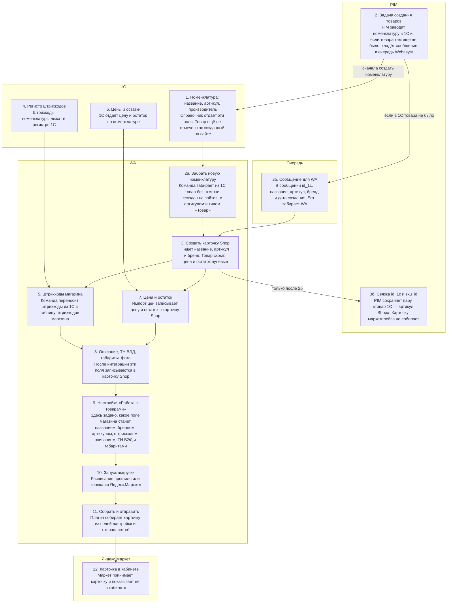

# Как данные карточки попадают в WA и что её выгружает

Статус: `draft`  
Дата: **2026-09-25** (срез диалога) · дополнено схемой 2026-09-28  
Код: WA `caroptics` · PIM `fastapi-pim` · плагины `odata1c`, `rabbitmq`, `rulimpcerts`, `ym`  
Связано: [ym-card-send-ozon-hook.md](ym-card-send-ozon-hook.md), [cards-ozon-wb.md](../as-is/cards-ozon-wb.md), [offer-1107932-mappings.json.md](../evidence/external/offer-1107932-mappings.json.md)

## Вывод

Карточка Маркета собирается **только из полей Shop**. 1С и PIM заполняют (или обновляют) карточку магазина, но **не** вызывают Partner API карточек. Выгрузку запускает плагин `ym` отдельно: расписание профиля или кнопка «в Яндекс.Маркет».

Очередь создания товаров в WA **пишет PIM** (задача создания товаров → сначала номенклатура в 1С → сообщение в RabbitMQ, только если товара в 1С ещё не было).

---

## Схема по системам (порядок)

| № | Система | Комментарий |
|---|---|---|
| 1 | 1С | В справочнике номенклатуры лежат название, артикул и производитель. Товар ещё не отмечен как созданный на сайте. |
| 2 | PIM | В очередь пишет PIM. Это происходит в задаче создания товаров: PIM сначала заводит номенклатуру в 1С, и только если такого товара в 1С ещё не было, кладёт сообщение в очередь Webasyst. |
| 2а | WA | Команда `shop odata1cImportCreateProducts` (профиль 7) забирает из 1С товар без отметки «создан на сайте», с артикулом и типом «Товар». |
| 2б | Очередь | Сообщение от PIM: `id_1c`, `name`, `sku`, `proizvoditel`, `create_datetime`. Имя очереди — `RABBITMQ_WA_QUEUE`. |
| 3 | WA | Создаётся карточка Shop: название, артикул, бренд (`proizvoditel`). Товар скрыт (`status=0`), цена и остаток нулевые. |
| 3б | PIM | После приёма очереди (`shop rabbitmqPluginRecieveCreateproduct`) WA публикует Kafka `ru.ruli.products.wa.mp_card_update`. PIM сохраняет связку `id_1c` ↔ `sku_id`. |
| 4 | 1С | Штрихкоды в `InformationRegister_ШтрихкодыНоменклатуры`. |
| 5 | WA | `shop odata1cPluginImportBarcode` → таблица `shop_product_barcodes`. Плагин `ym` эту таблицу не читает: в карточку Маркета уходит характеристика из настроек. |
| 6 | 1С | Отдаёт цену и остаток. |
| 7 | WA | Импорт цен обновляет цену и остаток в Shop. Название и описание не трогает. |
| 8 | WA | **После** интеграции (п. 1–7) в карточку записываются описание, ТН ВЭД, габариты и фото. Команды создания товара их не заполняют. |
| 9 | WA | Общие настройки плагина «Интеграция Яндекс.Маркет», блок «Работа с товарами» (`overall`). |
| 10 | WA | CLI `php cli.php shop ym {profile}` при `cli_upload_products` > 0 и env=cli, либо кнопка «в Яндекс.Маркет». |
| 11 | WA | `getDataForAddOfferByHash` → `POST …/offer-mappings/update`. |
| 12 | Яндекс Маркет | Карточка в кабинете. |

---

## Настройки: какое поле Shop уходит в карточку Маркета

Путь: Магазин → Плагины → Интеграция Яндекс.Маркет → общие настройки → **«Работа с товарами»**.  
Поля с `overall=1`: при сохранении копируются во все профили.

| Что на Маркете | Настройка | Откуда в Shop |
|----------------|-----------|---------------|
| Название | «Источник названия» | `p.name` или характеристика; опционально дописать артикул |
| Бренд | «Бренд» | характеристика |
| Артикул поставщика | «Код/артикул производителя» | `s.sku` / `s.name` / характеристика (склейки `артикул-sku_id` нет) |
| Штрихкод | «Штрихкод» | характеристика |
| Описание | «Описание» | `description` / `summary` / характеристика |
| ТН ВЭД | «ТН ВЭД» | характеристика → уходит массивом `customsCommodityCodes` |
| Габариты / вес | «Длина/Ширина/Высота упаковки», «Вес…» | характеристики размера / веса |

---

## Сообщение очереди (п. 2б) — тело от PIM

`ProductMaster.to_rabbitmq()`:

| Поле | Источник в PIM |
|------|----------------|
| `id_1c` | номенклатура 1С |
| `name` | `title_1c` |
| `sku` | артикул |
| `proizvoditel` | название бренда |
| `create_datetime` | дата создания в PIM (Екб) |

Если товар в 1С уже существовал, в очередь его **не** кладут.

---

## Прогон test.ruli.ru (SKU 1107932)

- Товар: `product_id` 1042543, `sku_id` 1107932, профиль теста **17** «[FBS] Ruli МСК 1 день».
- Кнопка «в Яндекс.Маркет» при выборе чекбоксом шлёт `hash[]=1042543` вместо `id/1042543` → коллекция 0 → UI «Отправлено без ошибок», API не вызывается.
- Рабочее тело Postman и отличие от плагина: [ym-card-send-ozon-hook.md](ym-card-send-ozon-hook.md), [offer-1107932-mappings.json.md](../evidence/external/offer-1107932-mappings.json.md).
- Лог фактического запроса WA: `wa-log/shop/plugins/ym/query.17.log` (если включён `log` в профиле).

---

## Якоря кода

| Система | Путь | Роль |
|---------|------|------|
| WA | `shop/plugins/odata1c/.../shopOdata1cImportCreateProducts.class.php` | Создание из 1С OData |
| WA | `shop/plugins/rabbitmq/.../shopRabbitmqPluginRecieveCreateproduct.cli.php` | Приём очереди + `publishCreateByProductId` |
| WA | `shop/plugins/rulimpcerts/.../shopRulimpcertsProductUpdateProducer.class.php` | Kafka `mp_card_update` |
| WA | `shop/plugins/ym/lib/config/profileFields.php` | Блок «Работа с товарами» |
| WA | `shop/plugins/ym/lib/classes/shopYmApi.class.php` | Сборка и POST карточки |
| PIM | `app/logic/commands/create_products/create_product.py` | Создание в 1С + `producer.send_message` |
| PIM | `app/infra/database/models/product_master.py` → `to_rabbitmq` | Тело сообщения в очередь |
